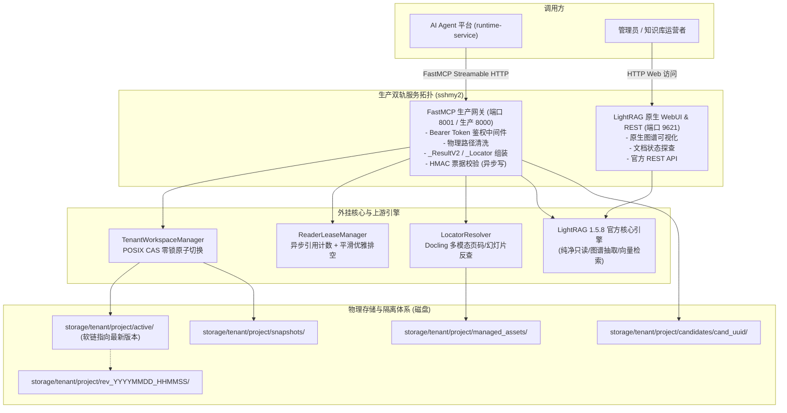

# LightRAG 生产级双轨知识库服务全面落地与平滑割接专项

- **立项时间：** 2026-10-16
- **核心目标：** 在 `sshmy2`（Ubuntu 24.04）上全面建立基于 LightRAG 1.5.8 的生产级双轨知识库底座，通过外挂式 FastMCP 网关对齐平台 0 代码改动契约（3 只读 + 2 写入 tools，`_ResultV2` / `_Locator` 规范），完成多租户物理隔离与零锁原子发布、Docling 多模态定位、存量数据无损迁移与快照回退，最终通过 systemd 完成生产平滑割接，彻底替代并退役旧版 `rag-anything-use`。
- **影响范围：** `sshmy2` 生产服务拓扑、FastMCP 生产网关、多租户存储引擎、多模态反查管道、数据迁移工具链。
- **当前状态：** 已完成（2026-10-16 全部 5 个阶段 14 项任务验证通过，双轨服务生产托管运行中）

---

## 核心底线承诺

1. **平台端 0 行代码修改**：
   - 上层 `ai-agent-platform`（包含 `runtime-service` 与 `platform-api`）不修改一行代码、不改动一个配置模型。
   - 网关对齐原有 FastMCP 4.1.0 协议规范与数据模型：严格兼容 `sources_version=1|2`、严格输出合法 `_ResultV2` / `_Locator` / `_Source`。
2. **LightRAG 核心 0 行代码侵入**：
   - 官方核心代码库 `lightrag/` 保持 100% 纯净，严禁在官方源码中增加任何平台私有逻辑或锁黑魔法。
   - 所有多租户隔离、鉴权控制、Docling 解析中间态反查、写任务异步调度全部封装在外挂网关层，保障上游可随时无缝通过 pip/git 升级。
3. **真实环境 100% 可验证**：
   - 所有验证命令、单测、契约测试、双轨探活全部以 `sshmy2` 真实执行为准，杜绝任何假报。

---

## 生产双轨架构蓝图

---

## 核心技术设计

### 1. 多租户物理隔离与 POSIX CAS 零锁原子切换
- 彻底摒弃旧版单体对 LightRAG 内部存储字典暴力打猴子补丁的脆弱做法。
- 每个租户/项目拥有独立的物理存储路径 `storage/<tenant_id>/<project_id>/`。
- 新知识入库或全量构建一律在独立的 `candidates/cand_<uuid>/` 中进行，构建失败直接物理清除，对在线查询 0 影响。
- 构建成功后，通过 Linux 内核级 `symlink` + `rename` 原子操作秒级将 `active` 指向新生成的 `rev_<ts>`，实现毫秒级零锁激活。

### 2. 细粒度异步读租约（Reader Lease）优雅退役
- `ReaderLeaseManager` 基于异步引用计数跟踪正在执行的在线检索。
- 版本切换发生后，旧版本实例标记为 `retired`：
  - 新进查询自动绑定最新激活的 `rev_<ts>` 实例；
  - 存量并发查询继续在旧实例上平滑执行，直至执行完毕租约释放；
  - 计数器归零后触发后台无阻塞资源释放，彻底消灭内存泄漏与文件锁竞争。

### 3. Docling 多模态可信页码（Locator）三级提取
- 针对 PDF/DOCX 支持 `unit="page"`，PPTX 支持 `unit="slide"`，MD/TXT 降级为 `unit="unknown"`。
- 解析阶段缓存 Docling 的 `.blocks.jsonl` 块索引与边界框。
- 检索召回时采用三级自适应文本定位算法：
  1. **Level 1（精确哈希匹配）**：快速命中精确 chunk 对应页面。
  2. **Level 2（滑动窗口归一化相似度）**：抗分词/截断干扰。
  3. **Level 3（文档首部安全兜底）**：防止非法格式穿透。
- 严格保证吐给平台的 `_Locator` 100% 合法，且绝不暴露服务器宿主机物理路径。

### 4. 平台异步入库写链路与 HMAC 鉴权
- 迁移并暴露平台写工具：
  - `mcp_submit_project_knowledge_document`
  - `mcp_get_project_knowledge_ingest_job`
- 严格校验平台 HMAC 签名票据，防止未授权上传。
- 构建任务持久化至 SQLite/文件任务队列，具备幂等防失 ACK 能力。

### 5. 存量知识数据平滑迁移与快照签名
- 编写专项迁移脚本扫描原旧版 1.4.12 知识库原件，在 1.5.8 候选工作区重建全新图谱与向量索引。
- 迁移完成后生成 `snapshot.json`，记录文件哈希与 SHA256 校验签名，支持秒级一键回退。
