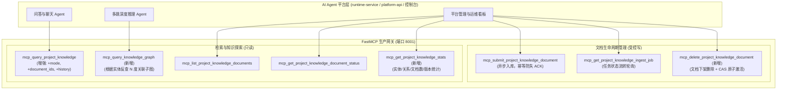

# LightRAG 平台级 MCP 工具矩阵全面增强与能力释放专项

- **立项时间：** 2026-10-16
- **核心目标：**
  在已投产的 5 个基础 MCP 工具底座之上，针对平台层团队在多 Agent 协同、精准问答、知识图谱推理、文档资产全生命周期管理及运维可观测性方面的核心痛点，进行无损升级与能力扩展：
  1. **检索接口无感增强**：对现有 `mcp_query_project_knowledge` 进行向后 100% 兼容的增强，增加可选参数 `mode`（支持 hybrid/local/global/naive/mix 5 种模式自主切换）、`document_ids`（单文档/多文档范围限定检索）及 `history_messages`（多轮指代消解）。
  2. **补齐文档全生命周期闭环**：新增 `mcp_delete_project_knowledge_document`，支持文档安全下架删除，并在独立的 Candidate 沙箱中剔除索引，通过 POSIX CAS 原子激活新版本。
  3. **释放知识图谱推理神力**：新增 `mcp_query_knowledge_graph`，支持按实体名反查 1~2 度关联子图（关联实体、关系标签与事实描述），供深度推理智能体做拓扑分析。
  4. **知识库可观测性与统计看板**：新增 `mcp_get_project_knowledge_stats`，提供总文档数、实体数、关系数、磁盘占用、当前版本 `rev_X` 与快照签名状态。
- **影响范围：** `gateway_mcp_server.py`、`workspace_manager.py`、`ingest_service.py`、测试套件。
- **当前状态：** 规划完成，准备开工

---

## 核心底线承诺

1. **平台现役调用 0 破坏（100% 向后兼容）**：
   - 现役平台的 `runtime-service` 调用的 5 个基础工具签名、必填入参和返回值结构完全保持原貌。
   - 所有新增功能均为新工具或现有工具的可选入参（默认值保持原有行为）。
2. **LightRAG 核心 0 侵入**：
   - `lightrag/` 源码保持纯净，所有子图截取、文档下架重建、多模态反查全部由外挂层调度。
3. **真实环境 100% 可验证**：
   - 所有单测与端到端测试均在 `sshmy2`（Ubuntu 24.04）上真实执行。

---

## 增强后 MCP 工具矩阵蓝图 (5 + 3 = 8 个工具)

---

## 架构与技术实现设计

### 1. 核心检索参数增强设计
在保持 `query`, `top_k`, `sources_version` 既有行为 100% 稳定的同时，增加：
- `mode: Literal["hybrid", "local", "global", "naive", "mix"] = "hybrid"`：动态构造 `QueryParam(mode=mode, top_k=top_k)`。
- `document_ids: Optional[List[str]] = None`：在召回 chunks 阶段，对返回列表按 `doc_id in document_ids` 进行精确匹配过滤。
- `history_messages: Optional[List[dict]] = None`：直接透传至 LightRAG 内部的 `history_messages`，由底层大模型在检索前完成多轮对话指代消解。

### 2. 知识图谱子图抽取设计 (`mcp_query_knowledge_graph`)
- LightRAG 底层在 `rev_<ts>/` 中持久化了 NetworkX 格式的 `graph_chunk_entity_relation.graphml`。
- 网关外挂直接复用已加载的 `rag.chunk_entity_relation_graph`（或通过 NetworkX 读取），针对传入的 `entity_name` 执行 BFS/DFS 邻居检索：
  - 返回节点信息（名称、实体类型、描述）；
  - 返回关联边信息（源节点、目标节点、关系权重、关系描述、支持度）；
  - 支持 `depth: int = 1`（1 度直接关系）或 `depth: int = 2`（2 度网络），返回干净紧凑的 JSON 拓扑。

### 3. 文档删除与版本重构设计 (`mcp_delete_project_knowledge_document`)
- 平台传入 `document_id: str`。
- 检查该文档是否存在；从 `managed_assets` 目录中删除该原件。
- 在独立的 `candidates/cand_del_<uuid>/` 中建立重构目录：
  - 复制基准图谱；
  - 调用 `rag.adelete_by_doc_id(doc_id)` 级联清理节点与边孤岛；
  - 或基于剩余文档在候选沙箱中执行安全增量修剪；
  - 修剪完成后调用 `atomic_publish_candidate` 进行 POSIX CAS 零锁激活并重新封存快照；
  - 更新 SQLite 任务与文档状态为 `deleted`。

### 4. 统计监控指标设计 (`mcp_get_project_knowledge_stats`)
- 汇总返回：
  - `tenant_id`, `project_id`, `active_version`
  - `total_documents`: 受管原件文档总数
  - `total_entities`: 知识图谱实体节点总数
  - `total_relations`: 知识图谱关系边总数
  - `total_chunks`: 文本分块总数
  - `storage_bytes`: 物理存储占用字节数
  - `snapshot_sealed`: 快照签名是否合规
  - `last_updated_at`: 最后版本激活时间戳
