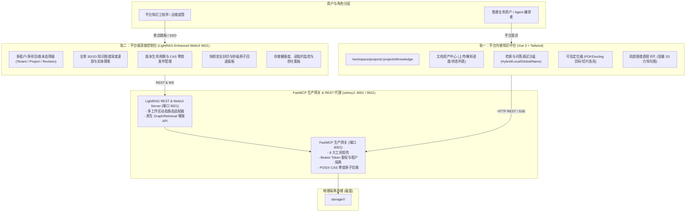

# 平台级 LightRAG 前端体系设计与双轨适配工程

- **立项时间：** 2026-10-16
- **核心目标：** 将已在 `sshmy2` 生产宿主机部署完毕的 LightRAG 1.5.8 演进为企业级/个人平台级知识库中台，完成面向上层消费平台 `ai-agent-platform` 的前端适配与架构落地，构建“业务级原生内嵌 + 平台级深度控制台”的双轨前端架构。
- **影响模块：**
  - LightRAG 外挂网关与 WebUI 适配层（`run_lightrag_webui_server.py`, `gateway_mcp_server.py`, `lightrag_webui/`）
  - 平台前端 `apps/platform-web`（新增项目级知识库管理与检索调试模块）
  - 平台后端 `apps/platform-api`（对接 FastMCP 网关 8 大工具矩阵与 REST 代理）
- **当前状态：** 方案规划与架构定型阶段

---

## 核心架构原则（铁律底线）

1. **LightRAG 核心 0 侵入**：严禁修改 `lightrag/` 官方核心源码，官方上游纯净度 100%，确保未来无缝升级 `git merge upstream/main`。
2. **平台端 0 破坏性契约改动**：平台现有 API 契约（`_ResultV2`, `_Locator`, `_Source`）保持 100% 兼容；前端页面完全对齐 `platform-web` 既有的 Vue 3 + Tailwind CSS 设计规范与组件规范。
3. **现场开发与验证闭环**：所有代码编写、构建与流水线验证全部在 `sshmy2`（Ubuntu 24.04）上进行，本地 Mac 仅作为代码同步镜像源。

---

## 现状技术痛点与架构缺陷分析

### 1. 现有官方原生 WebUI（端口 9621）的致命缺陷

LightRAG 官方自带的 `lightrag_webui` 是一个单体 React SPA，直接用于平台级别知识库存在严重水土不服：
- **物理目录硬编码单体绑定**：`run_lightrag_webui_server.py` 中 `WORKING_DIR` 静态绑定单版本路径，无法识别多租户/多项目路径（`storage/<tenant_id>/<project_id>/active`）。
- **鉴权体系彻底脱节**：官方前端仅支持简单的静态 Token 或无认证模式，无法对接平台基于 JWT Bearer（含租户、项目、权限作用域）的安全鉴权体系。
- **生产级生命周期能力盲区**：对我们已投产的“候选沙箱构建（Candidate Sandbox）”、“POSIX CAS 零锁原子发布”、“异步读租约排空”、“SHA-256 快照原子回退”、“Docling 多模态可信页码定位”等 8 大核心生产能力毫无感知，无法监控与操作。
- **UI 风格与平台割裂**：平台端整体技术栈为 Vue 3 + Tailwind CSS，原生 WebUI 孤立部署导致用户在平台与知识库之间割裂跳跃。

---

## 前端适配演进架构蓝图：双轨协同体系

老王推崇的工业级解决方案是 **“平台业务内嵌端 + 深度运维控制台” 双轨协同**：

---

## 模块分工与实现路线

### 轨一：平台端 `platform-web` 原生知识模块实现
1. **路由与权限挂载**：在 `apps/platform-web/src/router/routes.ts` 注册 `workspace-project-knowledge`，关联 `project.runtime.read / write` 权限。
2. **核心业务组件集**：
   - `KnowledgeDocumentList.vue`：文档列表、解析状态标签（`ready` / `processing` / `failed`）、安全删除。
   - `KnowledgeUploadModal.vue`：多格式文件上传，调用 `mcp_submit_project_knowledge_document`。
   - `KnowledgeQueryPlayground.vue`：支持模式切换（hybrid/local/global/naive）、Top-K 调节、多轮会话评测。
   - `ChunkLocatorViewer.vue`：展示检索命中的可信页码（page/slide）、可信度分值与高亮切片。

### 轨二：LightRAG 宿主机原生 WebUI 多租户增强
1. **工作区动态切换中继（Workspace Relay Middleware）**：
   - 改造 `run_lightrag_webui_server.py`，支持接收平台 JWT Token，动态绑定请求上下文的 `tenant_id` 和 `project_id`，将底层引擎实例定向到对应的 `active` 目录。
2. **扩展 8 大生产工具面板**：
   - 增加 CAS 版本发布可视化面板（查看 candidates 构建进度，一键触发原子切换）。
   - 增加快照版本树与一键回退触发器。
   - 图谱探查器对接 `mcp_query_knowledge_graph`，支持按实体深度 BFS 抽取子图，避免全图过载卡死。
