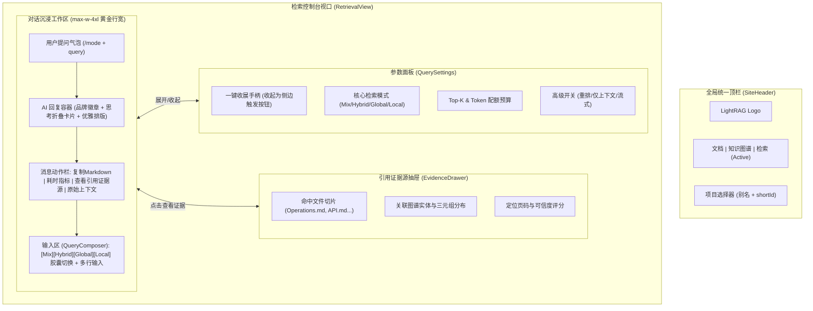

# LightRAG 检索对话控制台工业级重构与证据溯源工程 (Plan B)

- **时间：** 2026-10-17
- **目标：** 重构 WebUI 检索对话页面，实现黄金阅读行宽（中置呼吸感）、右侧参数栏一键收展、模式快捷胶囊、消息底部动作栏（复制/耗时/上下文透视），以及 RAG 核心引证与切片溯源抽屉（Sources & Evidence Drawer）。
- **影响模块：**
  - 前端对话视图容器（`lightrag_webui/src/features/RetrievalView.tsx`）
  - 消息列表与排版布局（`lightrag_webui/src/features/retrieval/MessageList.tsx`）
  - 消息渲染与动作栏（`lightrag_webui/src/components/retrieval/ChatMessage.tsx`）
  - 输入框与模式胶囊（`lightrag_webui/src/features/retrieval/QueryComposer.tsx`）
  - 参数侧边栏收起折叠（`lightrag_webui/src/components/retrieval/QuerySettings.tsx`）
  - 引用与切片溯源抽屉（`lightrag_webui/src/components/retrieval/EvidenceDrawer.tsx` [新组件]）
- **状态：** 规划中

## 核心承诺
- **平台端改动：** 0 行代码修改（完全不碰平台代码，完全兼容既有 API 契约）
- **上游侵入度：** 0 行代码侵入（`lightrag/` 核心源码保持官方纯净）
- **生产一致性：** 本地 Vite 打包构建，产物完整部署并验证于 `sshmy2`（Ubuntu 24.04）

## 方案架构与视觉蓝图

### 关键改进指标
1. **排版舒适度**：将文本行宽收敛至 `max-w-4xl` 居中容器，杜绝 2000px+ 视线漂移疲劳。
2. **沉浸式对话**：参数栏支持最小化折叠（宽度从 280px 变为 0 / 浮标），给内容释放完整视野。
3. **快速模式切换**：输入框上方一键点选 `Mix / Hybrid / Global / Local`，免去手动敲前缀或进菜单。
4. **证据与引证透视**：提取命中实体与切片，点击打开 Evidence Drawer 详细查看。
