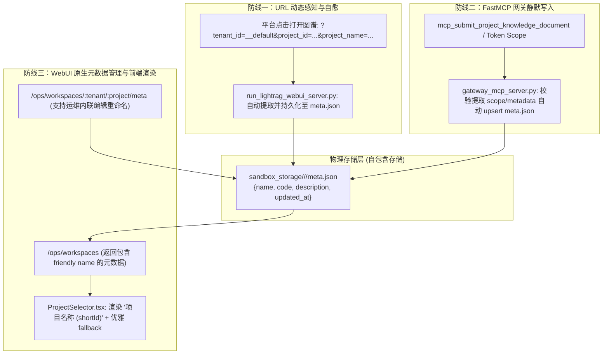

# 多租户知识库项目元数据与身份对齐彻底根治工程

- **时间：** 2026-10-17
- **目标：** 彻底解决 LightRAG WebUI (9621) 与上层平台项目身份脱节、UUID裸奔展示的问题，建立物理工作区自包含的元数据持久化体系与双向名字感知机制。
- **影响模块：**
  - WebUI 后端适配器（`run_lightrag_webui_server.py`）
  - 前端项目选择器组件（`lightrag_webui/src/components/ProjectSelector.tsx`）
  - FastMCP 网关外挂元数据沉淀（`gateway_mcp_server.py`）
- **状态：** 规划中

## 核心承诺
- **平台端改动：** 0 行代码修改（完全兼容 FastMCP 与 _ResultV2 契约，支持零摩擦自适应）
- **上游侵入度：** 0 行代码侵入（`lightrag/` 保持官方纯净，可随时升级）

## 方案概述

### 1. 根本痛点
当前 LightRAG WebUI 仅通过简单的目录遍历枚举 `sandbox_storage/<tenant_id>/<project_id>`，前端硬编码了 `11111111-1111-4111-8111-111111111111`（平台默认项目）与 `eval_benchmark`（评测基准）两个特例，对平台真实创建的业务项目 UUID（如 `5a5b7239-43e3-40e6-bba3-e64d96057607`）直接截断裸显，无法与平台业务名称对应。

### 2. 根治架构：自包含物理元数据 + 动态感知三道防线

### 3. 多租户与读租约保护
- `meta.json` 为项目目录根级别的元数据描述文件，不侵入 `revisions/rev_N`，完全不影响底层 LightRAG 引擎的 POSIX CAS 零锁原子版本切换与读租约引用计数。
