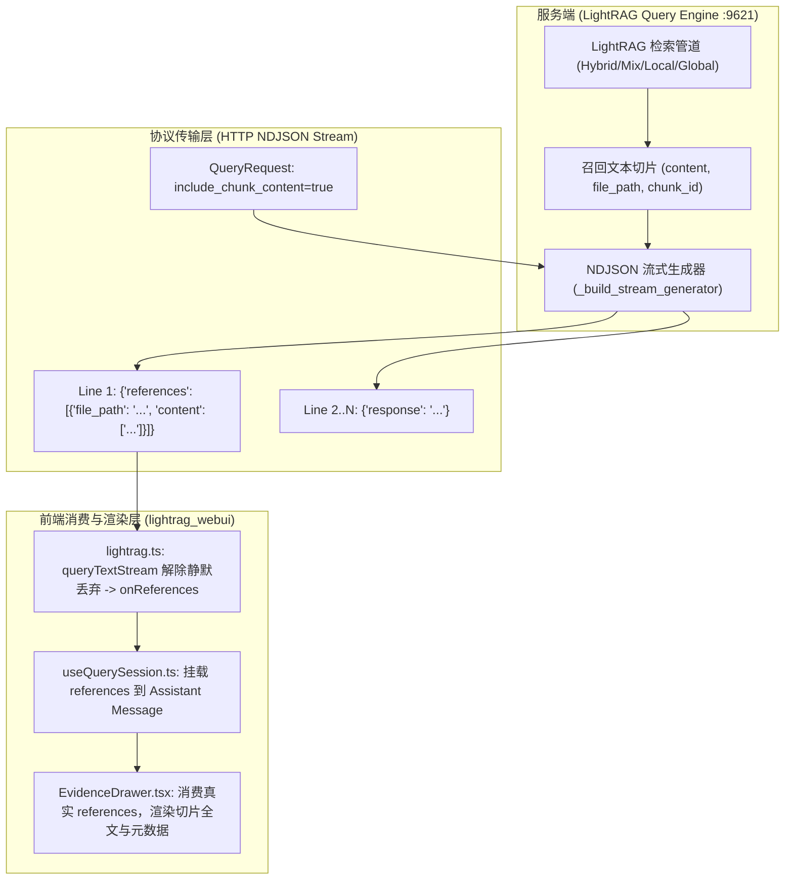

# LightRAG 检索真实切片证据溯源工业级落地工程

- **时间：** 2026-10-29
- **目标：** 彻底打通 WebUI 智能问答的真实证据溯源端到端闭环：启用服务端切片文本抓取、流式解除引用静默丢弃、废黜大模型草稿正则扒取伪逻辑、真实渲染召回切片正文与元数据。
- **影响模块：**
  - `lightrag_webui/src/api/lightrag.ts`（请求参数补充 `include_chunk_content`，流式解析暴露并分发 `references` 数据行）
  - `lightrag_webui/src/types/retrieval.ts`（`MessageWithError` 挂载标准结构化引用定义 `ReferenceItem`）
  - `lightrag_webui/src/features/retrieval/useQuerySession.ts`（会话管理接收并持久化 `references` 到当前 Assistant 消息）
  - `lightrag_webui/src/components/retrieval/EvidenceDrawer.tsx`（拔除正则提取伪逻辑，改为真实切片多卡片渲染、内容折叠与高亮）
  - `lightrag_webui/src/components/retrieval/ChatMessage.tsx`（按真实证据源数量展示徽章与入口，传递真实数据）
- **状态：** 规划中

## 核心承诺
- **平台端改动：** 0 行代码修改（`ai-agent-platform` 契约完全不受影响）
- **上游侵入度：** 0 行代码侵入（官方核心源码 `lightrag/` 保持 0 侵入，直接利用上游原生的 `include_chunk_content` 与 `references` 能力）
- **生产一致性：** 严格遵循 Remote-First 原则，在 `sshmy2`（Ubuntu 24.04）现场修改、构建、验证，杜绝双端覆盖

## 现状剖析与痛点根源

当前在 WebUI 问答工作台中，“证据溯源”抽屉存在严重的技术欺骗与体验断层：
1. **数据吞噬：** `lightrag_webui/src/api/lightrag.ts` 中流式解析显式声明 `// references-only lines are silently consumed`，将服务端首帧精准推送的结构化切片与文件元数据直接丢弃。
2. **伪造证据：** `EvidenceDrawer.tsx` 中的 `extractEvidenceFromMessage` 拿正则扫描大模型最终输出和 Thinking 思维链，遇到类似文件名后缀的单词就将大模型自己草稿里的话（如 `7 Operations.md content`、`Relationships: 40...`）截取为“证据切片”。
3. **不可信：** 用户打开证据抽屉，核实的不是原始知识库切片，而是大模型二传手的幻觉和碎碎念，失去了 RAG 系统最核心的 Fact-Checking 价值。

## 方案架构设计

## 技术要点与实现规范

1. **请求层显式透传：** 在 `QueryRequest` 中新增 `include_chunk_content?: boolean`，问答检索时默认启用 `true`。
2. **流式消费解耦：** 在 `queryTextStream` 的回调接口中追加 `onReferences?: (refs: ReferenceItem[]) => void`。解析到 NDJSON 包含 `references` 字段时，立刻向上传递，不再 `silently consumed`。
3. **状态持久化：** 在 `MessageWithError` 增加 `references?: ReferenceItem[]`。当 `onReferences` 触发时，实时更新当前 Assistant 消息状态。
4. **抽屉组件重塑：**
   - 彻底废黜 `extractEvidenceFromMessage`；
   - 优先消费 `message.references`，每个文件作为一个分组，按切片块列表展示真实的召回正文；
   - 支持切片全文阅读、字符长度透视、复制原文等实用功能；
   - 优雅兼容无切片返回时的明确空态提示（例如纯常识推理或未命中上下文）。
