# LightRAG NetworkX 单机内存优化与架构解耦工程

- **时间：** 2026-11-03
- **目标：** 坚守单机极简与 POSIX CAS 零锁物理隔离底座的前提下，彻底拆除 NetworkX 内存炸弹与反序列化抖动、消除沙箱构建全量物理文件写放大、上浮多租户 LRU 生命周期淘汰，并归还官方核心源码 100% 纯净度。
- **影响模块：**
  - `graph_explorer.py`（基于文件 `st_mtime` 增加图对象内存单例缓存，杜绝每次外部 Agent 工具调用重复反序列化巨大 XML）
  - `workspace_manager.py`（`TenantWorkspaceManager` 引入 `OrderedDict` LRU 实例淘汰机制，最大常驻实例可控；集成外挂运行时补丁）
  - `ingest_service.py`（候选沙箱 `_process_document_job` 与 `delete_document` 改用操作系统硬链接 `os.link`，避免全量物理拷贝导致的写放大）
  - `lightrag/kg/json_doc_status_impl.py` 与 `lightrag/kg/json_kv_impl.py`（恢复官方源码纯净度，将 `wdir_tag` 哈希逻辑抽离为外挂运行时补丁）
  - `llm_client.py`（实例化 LightRAG 默认注入 `addon_params={"language": "简体中文"}`，杜绝图谱抽取中英混杂）
- **状态：** 规划中

---

## 核心承诺 (Hard Commitments)

- **平台端改动：** 0 行代码修改（上层 `ai-agent-platform` 消费契约完全不受影响，8 大 FastMCP 工具矩阵签名与返回结构 100% 兼容）。
- **上游侵入度：** 0 行代码侵入（彻底消除对官方核心源码 `lightrag/` 的侵入改动，执行 `git status --porcelain lightrag/` 必须永远为空，确保随时可与 upstream/main 无缝合并）。
- **零过度设计 (KISS / YAGNI)：** 拒绝盲目上马重型图数据库（Neo4j）和分布式中间件，全靠操作系统级原生原语（`os.link` 硬链接、`st_mtime` 状态对齐、`LRU` 优雅析构）就地解决性能瓶颈。
- **生产一致性：** 严格遵循 Remote-First 原则，在 `sshmy2`（Ubuntu 24.04）现场修改、构建、验证，杜绝跨端覆盖。

---

## 现状剖析与痛点根源

当前在单机多租户运行环境下，系统存在以下 4 大性能与架构隐患：
1. **NetworkX 反序列化抖动：** `graph_explorer.py` 在响应 `mcp_query_knowledge_graph` 工具调用时，每次都硬调用 `nx.read_graphml(graph_path)`。面对几十兆的 XML 图文件，多跳推理连续触发时会导致 CPU 占用飙满和 GC 内存剧烈抖动。
2. **多租户实例无界泄漏：** `TenantWorkspaceManager._rag_instances` 采用纯 Dict 缓存，只有创建没有淘汰。长期运行下，几十个项目的 LightRAG 实例与 NetworkX 图对象常驻内存，存在单机 OOM 风险。
3. **沙箱物理拷贝写放大：** `ingest_service.py` 在构建候选目录和执行删除时，使用 `shutil.copy2` 对 `active` 目录全量文件进行物理深拷贝。项目数据达几百兆时，每次微小变更都会引发沉重的磁盘 IO 惩罚。
4. **核心源码遭到入侵：** 此前为了解决多租户共享内存命名空间冲突，直接修改了 `lightrag/kg/json_doc_status_impl.py` 和 `json_kv_impl.py`，违背了 `AGENTS.md` 中“上游 0 侵入”的军规红线。

---

## 方案架构设计

```mermaid
flowchart TD
    subgraph Gateway ["外挂层与运行时补丁 (Gateway & Bootstrap)"]
        BOOT["run_lightrag_webui_server.py / gateway_mcp_server.py / tests/conftest.py"]
        PATCH["apply_workspace_namespace_patch() 幂等运行时补丁"]
        BOOT --> PATCH
        PATCH -.->|"动态拦截 __post_init__ (0 源码修改)"| OFFICIAL["官方原生 JsonKVStorage / JsonDocStatusStorage"]
    end

    subgraph WorkspaceMgr ["多租户生命周期治理 (TenantWorkspaceManager)"]
        LRU["OrderedDict (max_cached_instances=8)"]
        EVICT["LRU 驱逐触发 -> lease_mgr.mark_retired(平滑优雅排空)"]
        LRU --> EVICT
    end

    subgraph IngestPipeline ["候选沙箱零拷贝构建 (KnowledgeIngestService)"]
        ACTIVE["active revision 物理目录"]
        CAND["candidates/cand_<uuid> 沙箱"]
        ACTIVE -->|"os.link 硬链接 (0 秒, 0 磁盘写放大)"| CAND
        CAND -->|"LightRAG 写入 (写 .tmp 触发原子解绑)"| PUBLISH["CAS 原子发布: active -> rev_N+1"]
    end

    subgraph GraphExplorer ["图谱查询缓存层 (GraphExplorer)"]
        TOOL_REQ["mcp_query_knowledge_graph 请求"]
        CACHE_CHECK{"_graph_cache: (path, mtime) 命中?"}
        TOOL_REQ --> CACHE_CHECK
        CACHE_CHECK -->|"Yes (纳秒级)"| RAM_HIT["直接复用内存 nx.Graph"]
        CACHE_CHECK -->|"No (仅在版本变动时)"| RELOAD["从磁盘加载一次 nx.read_graphml"]
    end
```

---

## 技术要点与实现规范

1. **运行时动态隔离补丁（防重重入与测试对齐）：**
   - 在网关与服务启动入口及 `tests/conftest.py` 执行 `apply_workspace_namespace_patch()`，动态 wrap 原生 `JsonKVStorage` 与 `JsonDocStatusStorage` 的 `__post_init__` 方法；内置幂等检查防止多重包装；
   - 还原 `lightrag/kg/json_doc_status_impl.py` 与 `json_kv_impl.py` 的源码修改，恢复 git 纯净。
2. **硬链接极速沙箱 (Fast Candidate Linking)：**
   - 提取 `fast_candidate_link(source_dir, target_dir)` 工具函数；
   - 遍历 `active` 目录中的文件时，使用 `os.link(src, dst)` 创建硬链接；当跨设备/分区抛出 `OSError` 时，平滑降级为 `shutil.copy2`；
   - 依托 LightRAG 底层 `atomic_write`（写 `.tmp` 再 `os.replace`），写入时天然 break link，源文件安全无损。
3. **LRU 租户实例池与读租约优雅排空：**
   - `TenantWorkspaceManager` 内部维护带上限（默认 8）的 `OrderedDict`；
   - 命中时 `move_to_end`；满额驱逐旧实例时，禁止直接关闭底层存储，必须通过 `lease_mgr.mark_retired(..., cleanup_callback=lambda rag: rag.finalize_storages())` 等待在读租约清零后平滑排空断开。
4. **基于 mtime 的图谱单例缓存：**
   - `GraphExplorer` 内部增加 `_graph_cache: Dict[str, Tuple[float, nx.Graph]]`；
   - 每次查询前对比 `graph_path.resolve()` 与 `stat().st_mtime`，未更新则直接返回内存对象，性能提升数千倍。
5. **抽取提示词锁死简体中文：**
   - 在 LightRAG 初始化传参时，注入 `addon_params={"language": "简体中文"}`，彻底消除实体抽取中英混杂。
