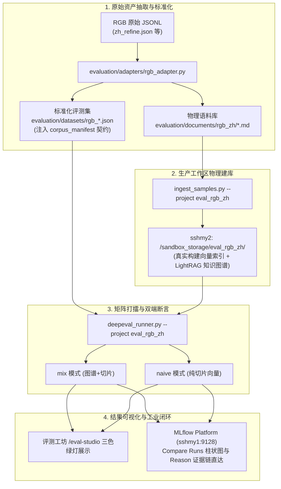

# 华为诺亚方舟 RGB 评测基准端到端工业化接入专项

- **时间：** 2026-11-16
- **目标：** 将华为诺亚方舟经典 RAG 评测基准（RGB: Retrieval-Augmented Generation Benchmark）完整解耦并工程化接入 LightRAG 外挂评测体系，实现中英文双语料物理建库、四大能力集（噪声鲁棒、负面拒答、信息整合、反事实抗扰）契约标准化、专项断言器扩展以及图谱打擂（Mix vs Naive）在 MLflow 的量化大屏呈现。
- **影响模块：**
  - `evaluation/adapters/rgb_adapter.py` (新增: 原始 RGB 数据清洗、语料抽取与契约转换器)
  - `evaluation/documents/rgb_zh/` 与 `evaluation/documents/rgb_en/` (新增: 物理语料原材料)
  - `evaluation/datasets/` (新增: 标准化评测集 `rgb_zh_noise.json`, `rgb_zh_rejection.json`, `rgb_zh_integration.json`, `rgb_zh_counterfactual.json`)
  - `evaluation/deepeval_runner.py` (扩展: 挂载拒答负样本断言与反事实检出断言)
  - `evaluation/README.md` (更新使用指南)
- **状态：** 规划中

---

## 核心承诺 (Architecture Invariants)

- **平台端改动：** 0 行代码修改（完全兼容 FastMCP 与 `_ResultV2` / 平台 JWT 鉴权契约）
- **上游侵入度：** 0 行代码侵入（`lightrag/` 官方核心算法库保持 100% 纯净，随时无冲突 `git merge upstream/main`）
- **真实生产闭环：** 所有修改、数据抽取、切片建库与打擂验证均在 `sshmy2`（Ubuntu 24.04）现场运行真实子进程，结果全量落库至 `sshmy1:9128` 生产 MLflow，绝不使用 Mock 糊弄。

---

## 方案深度剖析与架构突破

### 1. 痛点：RGB 原版局限与工业级 RAG 评测断层
华为 RGB 论文是 RAG 领域的里程碑之作，但官方开源代码（`chen700564/RGB`）存在一个脱离工程实际的硬伤：
- **“只评测 Reader 生成器，不评测 Retriever 检索器”**：原版 `evalue.py` 是离线脚本，通过 Python 内存列表手动把正负例切片拼成 `DOCS` 塞给 LLM 窗口，完全跳过了“真实大规模知识库检索、向量召回、图谱多跳与重排（Rerank）”的核心环节！
- **我们的架构突破**：
  将 RGB 从“离线 LLM 上下文问答测试器”升级为**“端到端全链路物理 RAG 质检基准”**！
  1. 将 RGB 中的正负段落还原为物理 Markdown 文档，通过 `ingest_samples.py` 在专属测试租户（如 `eval_rgb_zh`）真实构建 LightRAG 实体知识图谱与向量索引；
  2. 测试时向 `/query` 发送真实 HTTP 请求，考察 LightRAG 面对大规模知识库时，图谱+向量能否从上千个切片中精准捞出正向证据，并在负样本时坚决拒答。

### 2. 评测集分类与四大核心能力映射

| RGB 原始子集 | 题目规模 | 考察核心能力 | 原版断言方式 | LightRAG 适配断言与指标 |
|---|---|---|---|---|
| `zh_refine.json` (低噪声) | 300 题 | **噪声鲁棒性 (Noise Robustness)** | 字符串子串命中 | DeepEval 4 大黄金指标 (忠实度、召回率、精密度、相关度) |
| `zh_refine.json` (全噪声) | 300 题 | **负面拒答 (Negative Rejection)** | GPT-3.5 拒答二分类 | 挂载专属 `RefusalMetric`，断言回答包含未登录明确拒答，拒答率即得分 |
| `zh_int.json` | 100 题 | **信息整合 (Information Integration)** | 两个子问题全命中 | 重点考察图谱高阶跳数召回率与 Contextual Recall，验证 Graph 相比 Naive 优势 |
| `zh_fact.json` | 100 题 | **反事实抗扰 (Counterfactual)** | GPT-3.5 检出二分类 | 识别材料事实错误 (Error Detection) 与纠错 (Correction) 诊断断言 |

### 3. 数据流与工程实施拓扑

