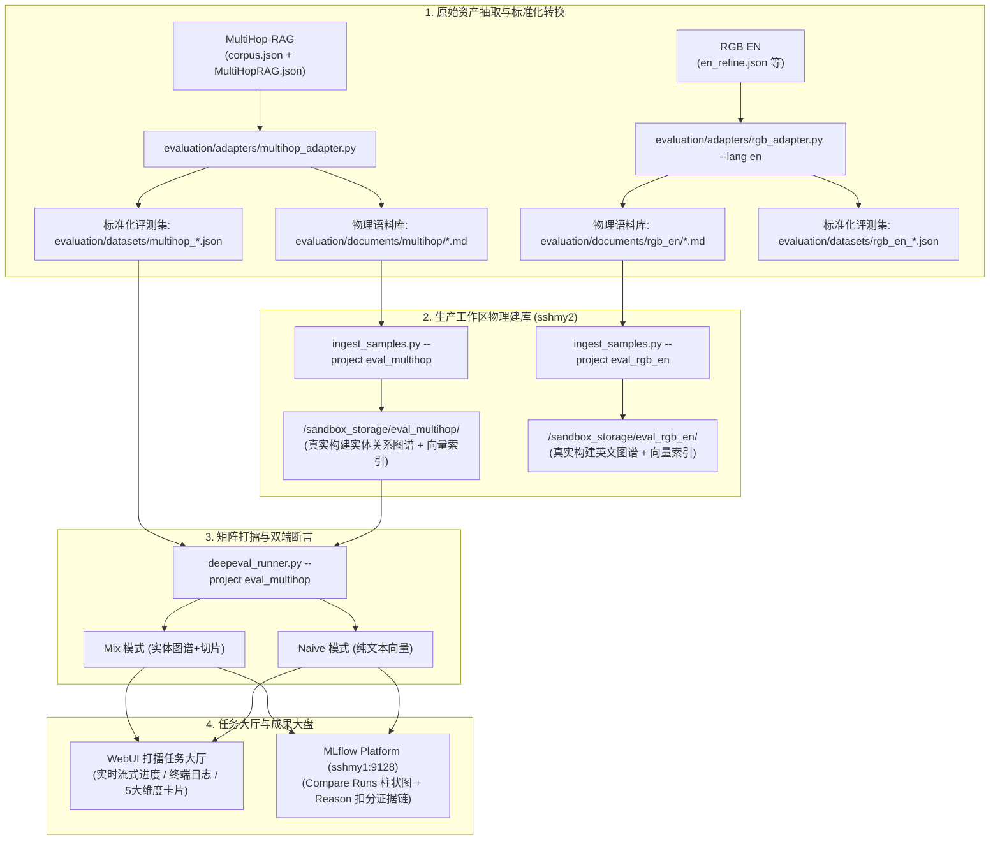

# MultiHop-RAG 权威多跳基准与 RGB 英文评测集工业化接入

- **时间：** 2026-11-16
- **目标：** 将 COLM 2024 权威多跳问答评测基准 `MultiHop-RAG`（2556 题 / 609 篇新闻语料）以及华为诺亚方舟 `RGB (EN)` 英文评测基准全面解耦并工程化接入 LightRAG 外挂评测底座。实现真实物理语料切片建库、四大多跳类型（推理、比对、时序、证据不足拒答）契约标准化、专属断言扩展以及图谱打擂（Mix vs Naive）在 WebUI 任务大厅与 MLflow 的量化大屏呈现。
- **影响模块：**
  - `evaluation/adapters/multihop_adapter.py` (新增: MultiHop-RAG 语料与考题标准转换器)
  - `evaluation/adapters/rgb_adapter.py` (验证/导出: 华为 RGB 英文版语料与评测集)
  - `evaluation/documents/multihop/` (新增: MultiHop 物理 Markdown 语料库)
  - `evaluation/documents/rgb_en/` (新增: RGB-EN 物理 Markdown 语料库)
  - `evaluation/datasets/multihop_*.json` (新增: 4 大专项多跳题库 + 1 份综合精选题库)
  - `evaluation/datasets/rgb_en_*.json` (新增: 4 大英文标准化评测集)
  - `evaluation/deepeval_runner.py` (增强: 适配英文多跳断言与 `null_query` 拒答判定)
  - `evaluation/README.md` (更新使用指南)
- **状态：** 规划中

---

## 核心承诺 (Architecture Invariants)

- **平台端改动：** 0 行代码修改（完全兼容 FastMCP 与 `_ResultV2` / 平台 JWT 鉴权契约）
- **上游侵入度：** 0 行代码侵入（`lightrag/` 官方核心算法库保持 100% 纯净，随时无冲突 `git merge upstream/main`）
- **真实生产闭环：** 所有修改、数据抽取、切片建库与打擂验证均在 `sshmy2`（Ubuntu 24.04）现场运行真实子进程，结果全量落库至 `sshmy1:9128` 生产 MLflow，绝不使用 Mock 糊弄。

---

## 方案深度剖析与架构突破

### 1. 痛点：MultiHop-RAG 原版局限与图谱 RAG 终极检验

MultiHop-RAG (COLM 2024) 是业内公认评测 RAG“跨文档多跳推理”最硬核的权威基准：
- **核心特性**：覆盖 2556 道高质量复杂查询，每道题的证据链分布在 2 到 4 篇不同文档中，必须结合多篇文档的元数据（作者、发布时间、来源）与实体关系才能得到最终答案。
- **原版局限**：原版代码仅依赖简单的向量或 BM25 检索拼接（`simple_retrieval.py`），对跨文档关系毫无建模能力，遇到复杂多跳召回率极低。
- **我们的架构突破**：
  将 MultiHop-RAG 改造为**“检验 LightRAG 双级知识图谱碾压传统纯向量检索”的试金石**！
  1. **物理文档建库**：将 609 篇真实新闻（或精选子集）解耦还原为标准 Markdown，在 `eval_multihop` 专属测试租户物理入库，由 LightRAG 抽取跨文档实体、同义关系与全局图谱；
  2. **多跳能力分级**：将 2556 题按题型严谨拆解为 4 大子集，配合 `corpus_manifest` SHA-256 签名，接入 WebUI 评测工坊：
     - **逻辑推理 (Inference)**：跨多实体多属性逻辑链推导；
     - **实体比对 (Comparison)**：跨多文档同类属性与数值比对；
     - **时序分析 (Temporal)**：时间先后演进与历史因果多跳；
     - **负面拒答 (Null Query)**：证据链不全或缺失，断言系统回答“Insufficient information.”，杜绝幻觉妄断。
  3. **RGB 英文集无缝合流**：同步激活 `rgb_adapter.py --lang en`，补齐英文环境下的噪声鲁棒性与反事实抗扰评测。

---

### 2. 评测集分类与核心能力映射

| 基准来源 | 评测集 ID | 题型/维度 | 考察核心能力 | 预期打擂效果 (Mix vs Naive) |
|---|---|---|---|---|
| **MultiHop-RAG** | `multihop_inference` | 推理多跳 (Inference) | 跨 2~4 篇文档的逻辑实体跳跃 | **Mix 完胜**（图谱多跳直接串联关联实体，Naive 向量单步断链） |
| **MultiHop-RAG** | `multihop_comparison`| 实体比对 (Comparison) | 跨文档同维度属性与数值对比 | **Mix 优势显著**（实体属性在图谱节点显式聚合） |
| **MultiHop-RAG** | `multihop_temporal`  | 时序演进 (Temporal) | 结合时间元数据的先后事件判定 | **Mix 优势显著**（关系边携带时间演进线索） |
| **MultiHop-RAG** | `multihop_null`      | 证据不足 (Null Query) | 证据断裂时明确拒答 | **两者持平**（检验 RefusalAssertionMetric 识别率） |
| **MultiHop-RAG** | `multihop_benchmark` | 综合精选集 (Comprehensive) | 每类均衡抽样（共 30~50 题） | **日常 CI/CD 打擂首选基准** |
| **Huawei RGB (EN)** | `rgb_en_noise`       | 英文噪声鲁棒性 | 英文长文本干扰下的精确锁定 | 检验英文 Embedding 与检索重排精密度 |
| **Huawei RGB (EN)** | `rgb_en_rejection`   | 英文负面拒答 | 未登录英文知识断言拒答 | 考核英文提示词下的拒答率 |
| **Huawei RGB (EN)** | `rgb_en_integration` | 英文跨段整合 | 英文多事实聚合召回 | 验证英文语境下的图谱召回表现 |
| **Huawei RGB (EN)** | `rgb_en_counterfactual`| 英文反事实抗扰 | 英文材料事实错误检出 | 检验英文裁判下的 Error Detection |

---

### 3. 数据流与工程实施拓扑

