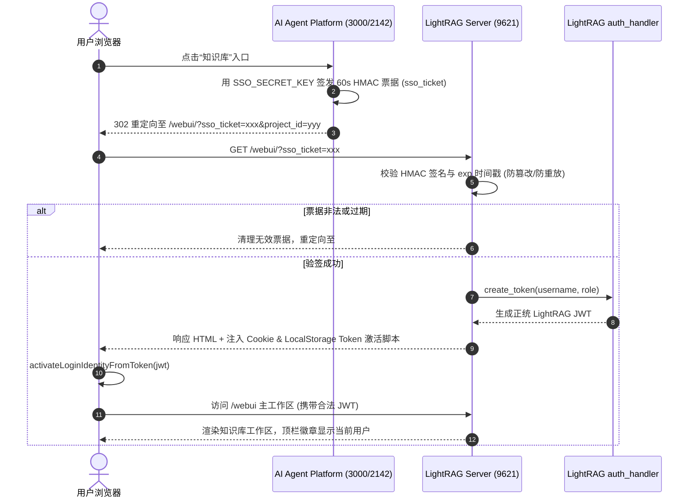
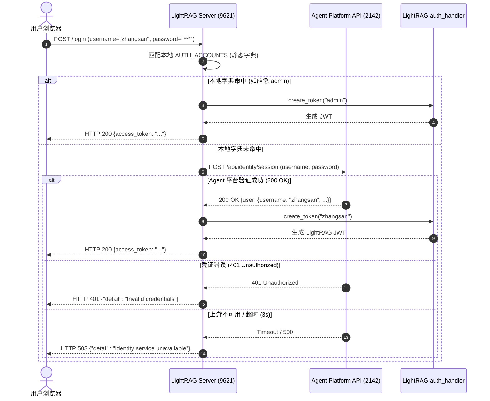

# 知识库三位一体统一认证与单点登录体系 (Unified Auth & Cross-System SSO)

- **创建时间：** 2026-11-16
- **版本编号：** v1.0.0
- **负责系统：** LightRAG 知识库 (生产常驻 `sshmy2:9621`)
- **联动系统：**
  - AI Agent 主平台 (`ai-agent-platform`, 核心身份源，API: 2142 / Web: 3000)
  - 大模型评测平台 (`mlflow-eval-platform`, 评测底座，Web: 9128 / API: 5000/5001)
- **核心承诺：**
  - **上游核心 0 侵入**：严格坚守 LightRAG 生产底座红线，`lightrag/` 官方核心库代码 0 行修改 (`git status --porcelain lightrag/` 严格为空)。
  - **开发范式严格遵循 Remote-First**：设计完成后，所有代码修改、集成与流水线验证均在 `sshmy2` 宿主机现场执行闭环。
  - **安全零信任**：彻底废弃 URL 裸露长期 JWT 的高危方式，全面升级为 60 秒阅后即焚 Presigned HMAC SSO Ticket 与委托穿透鉴权。

---

## 1. 业务诉求与现状痛点深度剖析

当前用户拥有 **AI Agent 平台**、**评测平台 (mlflow-eval-platform)** 和 **RAG 知识库 (LightRAG)** 三大系统。

### 现状与致命痛点
1. **账号系统割裂，无法互通：**
   - LightRAG 原生仅支持静态环境变量 `AUTH_ACCOUNTS=admin:admin123456`，解析为内存字典。
   - 用户在 AI Agent 平台注册或创建的新账号（如评测员、业务开发者、学生），在 LightRAG 中完全无法登录。
2. **免密跳转存在安全隐患与硬编码“伪 SSO”：**
   - 当前 `run_lightrag_webui_server.py` 中，如果未带 Token，直接硬编码签发了 `admin` 的一年超长 Token (`auth_handler.create_token(username="admin", role="admin", custom_expire_hours=24 * 365)`)。
   - 这导致任何人只要访问知识库 WebUI，全部被强制当成 `admin` 甚至自动注入 `LIGHTRAG-PREVIOUS-USER: admin`，多租户身份和操作审计彻底失效！
   - 原 URL 传参模式 `?token=<PLATFORM_JWT>` 容易被浏览器历史记录、Referer 头和代理网关窃听泄露。
3. **独立登录体验断层：**
   - 当用户不想先开 Agent 平台，而是直接在浏览器打开 LightRAG 知识库 URL 时，必须重新找管理员要专属密码，无法使用在 Agent 平台已有的账号密码直接登录。

---

## 2. 核心架构设计：三位一体统一认证模型

本方案构建 **“单一信任源 (Single Source of Truth) + 短期票据 SSO + 穿透委托鉴权”** 的标准化现代身份认证架构：

```
                    ┌─────────────────────────────────────────┐
                    │       AI Agent Platform (主平台)        │
                    │   (PostgreSQL 集中账号/权限管理中心)     │
                    │       身份鉴权 API 端口: 2142            │
                    └──────────────────┬──────────────────────┘
                                       │
            ┌──────────────────────────┴──────────────────────────┐
            │ 1. 签发 Presigned SSO Ticket (HMAC-SHA256, 60s)    │ 2. 委托穿透鉴权 (POST /api/identity/session)
            ▼                                                     ▼
┌───────────────────────────────────────┐             ┌────────────────────────────────────────┐
│     大模型评测平台 (mlflow-eval)       │             │       LightRAG 知识库 (WebUI: 9621)    │
│  (支持 SSO 兑换 + 穿透委托鉴权)       │             │   (支持 SSO 兑换 + 穿透委托鉴权)       │
└───────────────────────────────────────┘             └────────────────────────────────────────┘
```

### 场景 A：从 Agent 平台免密跳转直通知识库 (Presigned SSO Ticket)
1. **票据签发：** 用户在 Agent 平台点击“知识库”按钮，Agent 平台调用内部票据工具生成 Presigned Ticket：
   ```json
   {
     "username": "zhangsan",
     "tenant_id": "tenant-uuid-123",
     "project_id": "project-uuid-456",
     "role": "user",
     "exp": 1731720060,
     "sign": "hmac_sha256(username + tenant_id + exp, SSO_SECRET_KEY)"
   }
   ```
2. **跳转直达：** 浏览器跳转到 `http://49.233.222.54:9621/webui/?sso_ticket=<TICKET>`。
3. **外挂验签与本地发号：**
   - LightRAG 外挂中间件拦截该请求，使用共享的 `SSO_SECRET_KEY` 验证 HMAC 签名与有效时间（TTL <= 60s，防重放）；
   - 验证通过后，调用 LightRAG 原生的 `auth_handler.create_token(username=ticket.username, role=ticket.role)` 生成正统的 LightRAG Session JWT；
   - 将该 JWT 注入当前响应 Cookie 并通过前端存储脚本无缝激活，用户直接进入知识库主界面，顶栏徽章显示 `[ZH] zhangsan`，具备其对应的租户项目上下文！

### 场景 B：独立打开 LightRAG 登录页直连登录 (Pass-Through Identity Delegation)
1. **表单提交：** 用户打开 `http://49.233.222.54:9621/webui/#/login`，输入自己在 Agent 平台的账号密码（如 `zhangsan` / `mySecret123`）。
2. **外挂认证拦截器：**
   - LightRAG 外挂服务拦截 `/login` 接口请求；
   - **Step 1 (本地兜底)：** 优先检查本地 `AUTH_ACCOUNTS`（保障在 Agent 平台维护或断网时，宿主机运维管理员 `admin` 依然能本地登录）；
   - **Step 2 (穿透委托)：** 若本地未命中，外挂认证器异步调用 Agent 平台的鉴权端点：
     `POST http://<agent-platform-host>:2142/api/identity/session`
     Payload: `{"username": "zhangsan", "password": "mySecret123"}`；
   - **Step 3 (签发令牌)：**
     - 若 Agent 平台返回 HTTP 200，表明凭证真实有效。LightRAG 认证器立即调用 `auth_handler.create_token("zhangsan")` 签发合法的 LightRAG JWT 并按官方契约返回；
     - 若 Agent 平台返回 HTTP 401，LightRAG 精准返回 401 `Invalid credentials`；
     - 若超时（默认 3 秒超时控制），优雅降级返回 503 提示上游身份中心不可用。
3. **密码一致性保障：** 用户在 Agent 平台修改密码后，LightRAG 无需做任何定时任务同步或消息队列同步，下一次登录自动实时生效！完全符合 KISS 与 DRY 原则。

---

## 3. 详细时序图

### 时序图 1：Agent 平台免密跳转 LightRAG (SSO Ticket 兑换)


### 时序图 2：LightRAG 独立账号密码登录 (穿透委托鉴权)


---

## 4. 0 侵入技术实施路线与外挂工程方案

坚守 `lightrag/` 官方核心 0 侵入原则，所有改动全部收敛于外挂服务与中间件：

1. **外挂 SSO 票据与委托鉴权模块 (`sso_auth_delegator.py`)：**
   - 独立纯 Python 模块，不修改任何港大原生文件；
   - 封装 HMAC-SHA256 验签逻辑（`verify_sso_ticket`）；
   - 封装 HTTP 客户端穿透鉴权逻辑（`delegate_authenticate_to_agent_platform`，设置 3s 严格超时与连接池）。
2. **外挂 WebUI 服务入口挂载 (`run_lightrag_webui_server.py`)：**
   - 改造现有第 1320-1370 行的 SSO 处理逻辑：彻底删除无脑签发 `admin` 的危险代码！
   - 支持 `?sso_ticket=` 参数解析与校验；
   - 包装 `/login` 路由（或作为 ASGI 中间件前置拦截）：优先穿透鉴权，成功后调用 `auth_handler.create_token` 签发原生 JWT；
   - 保留 `/auth/sso-exchange` 标准 REST 端点。
3. **前端 WebUI 体验升级 (`lightrag_webui`)：**
   - 增强 `LoginPage.tsx`：当检测到 URL 带有 `sso_ticket` 时，自动发起票据兑换并无感登录；
   - 登录失败时给出清晰明确的 Toast 提示（区分“密码错误”与“身份服务不可用”）；
   - 完善退出登录与多用户切换时的缓存清理（确保历史会话不串门）。

---

## 5. 环境变量与安全配置规划

在 `sshmy2` 宿主机 `/home/ubuntu/lightrag-v2-exploration/LightRAG/.env` 中新增以下配置项：

```bash
# ==========================================
# 三位一体统一认证与 SSO 配置
# ==========================================
# 与 AI Agent 平台对齐的 HMAC 共享密钥
SSO_SECRET_KEY="your-sso-hmac-shared-secret-must-be-long-and-random"

# AI Agent 平台内部鉴权 API 地址 (供穿透鉴权使用)
AGENT_PLATFORM_API_URL="http://127.0.0.1:2142" # 若同机或通过局域网/公网 IP

# SSO 票据有效容差时间 (秒)
SSO_TICKET_TTL_SECONDS=60

# 本地运维后门/紧急恢复账号 (仅保留 admin 作为紧急兜底)
AUTH_ACCOUNTS="admin:admin123456"
TOKEN_SECRET="lightrag-native-token-secret"
```

---

## 6. 预期收益与风险评估

### 预期收益
- **用户体验无缝化：** 用户只需在 Agent 平台维护一套账号，跨平台无感跳转；独立访问任意子系统均可直接用同一套账号密码登录。
- **运维成本极小化：** 零数据库依赖，LightRAG 无需维护庞大的用户表和同步任务。
- **高安全性：** 彻底杜绝长期 Token 在 URL 泄露的风险，消灭任何游客伪装 admin 的漏洞。

### 风险控制
- **网络分区风险：** 若 Agent 平台因维护宕机，LightRAG 本地管理员账号 `admin:admin123456` 仍可通过本地字典直接登录，系统不至于彻底瘫痪。
- **上游侵入风险：** 实施后触发 `upstream-guard`，确保 `git status --porcelain lightrag/` 绝对为空。
