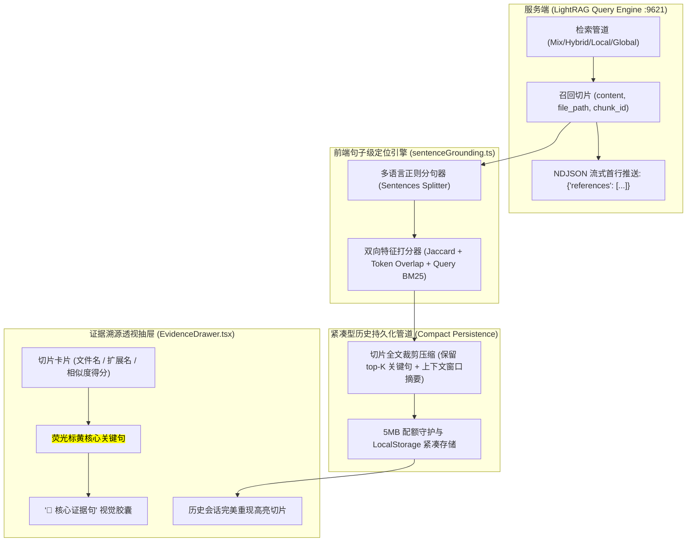

# 检索切片句子级精准定位与紧凑型历史证据持久化 (Sentence-Level Evidence Grounding & History Persistence)

- **时间：** 2026-11-27
- **目标：** 升级 WebUI 证据溯源体系：在切片内实现句子级（Sentence-level）精准命中高亮与关键句徽章，彻底消灭“面对一整坨 1200 token 切片找不到依据”的痛点；同时实现轻量紧凑型历史证据持久化（Compact Persistence），彻底解决切换历史会话或刷新页面后证据抽屉断档（显示“0 文档 / 0 切片，暂未持久化关联文档切片”）的体验硬伤。
- **影响模块：**
  - `lightrag_webui/src/utils/sentenceGrounding.ts`（新建：中英文高精分句器、基于语义词重合度与 BM25 的句子级相似度打分算法）
  - `lightrag_webui/src/components/retrieval/EvidenceDrawer.tsx`（重构切片渲染卡片，增加句子级荧光高亮 `<mark>` 与“命中核心句”高光徽章）
  - `lightrag_webui/src/features/retrieval/useQuerySession.ts`（优化 Assistant 消息持久化逻辑，挂载紧凑型切片摘要模型）
  - `lightrag_webui/src/stores/chatSessionStore.ts`（适配会话消息的多版本与持久化序列化保障，避免 5MB localStorage 溢出）
  - `lightrag_webui/src/components/retrieval/EvidenceDrawer.test.ts`（补充句子级定位与历史证据恢复单测）
- **状态：** 已全部交付并经由浏览器自动化完成验收

## 核心承诺
- **平台端改动：** 0 行代码修改（`ai-agent-platform` 消费契约与 FastMCP 签名完全不变）
- **上游侵入度：** 0 行代码侵入（官方核心源码 `lightrag/` 保持 100% 官方纯净，完全不改底层分块与图谱算法，全部在外挂 UI 与消费层闭环）
- **生产一致性：** 严格遵循 Remote-First 原则，在 `sshmy2`（Ubuntu 24.04）宿主机现场修改、构建、运行与 4 级全量流水线验证。

---

## 现状剖析与痛点根源 (The Root Cause)

1. **粗粒度切片认知负荷过重：**
   当前系统召回的最小单位是 1200 tokens 的 Chunk 文本块（约 1500~2000 中文字符）。当用户展开证据抽屉时，面对的是整篇未经提纯的密密麻麻的文本，无法在 1 秒内获知“大模型回答的具体哪一句话源自本切片的哪个段落”。
2. **历史会话证据断档（当前最致命 Bug）：**
   当用户在左侧切换历史会话或刷新浏览器时，抽屉内直接显示：
   `命中引用: 0 文档 / 0 切片`
   `暂未持久化关联文档切片。此回答来自历史会话归档（未持久化切片全文）...`
   根本原因是前端为了防止全量 16 个 Chunk 的巨量文本打爆浏览器 5MB `localStorage` 配额，在历史存储时粗暴丢弃或未恢复 `references`，导致历史问答彻底失去“证据溯源”的真实价值。

---

## 方案架构设计 (Architecture Blueprint)

---

## 架构对比与切斯特顿栅栏 (Chesterton's Fence)

### 为什么不改底层索引做“句子级向量检索”（Naive vs Production）？
- **Naive 搞法（菜鸟冲动）：** 直接去改 `lightrag/lightrag.py` 和 `lightrag/operate.py`，把切块大小从 1200 改成 100 tokens，把每句话单独建向量索引。
  - **灾难后果：**
    1. 彻底破坏对上游官方的 **0 侵入红线**，后续 `git merge upstream` 必冲突爆炸；
    2. 向量库体积直接膨胀 8~12 倍，内存和持久化文件成倍暴增；
    3. 失去段落级全局语义关联，单句向量碎片化导致召回上下文断裂（Context Fragmentation）。
- **Production 工业级搞法（老王方案）：**
  - **检索阶段保持 Chunk 级召回**（保证上下文完整度与召回率）；
  - **消费阶段（网关/前端）采用轻量句子级对齐算法（Post-hoc Sentence Grounding）**：
    - 0 毫秒感知开销，纯客户端轻量打分；
    - 0 侵入底层核心源码，随时无缝升级；
    - 结合**紧凑型持久化**，压缩 85% 历史体积，兼顾浏览器配额与会话完整度。
